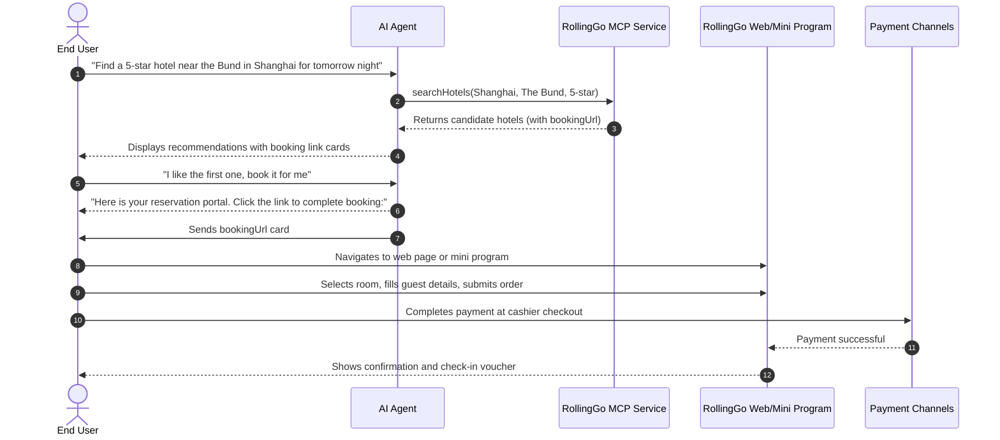
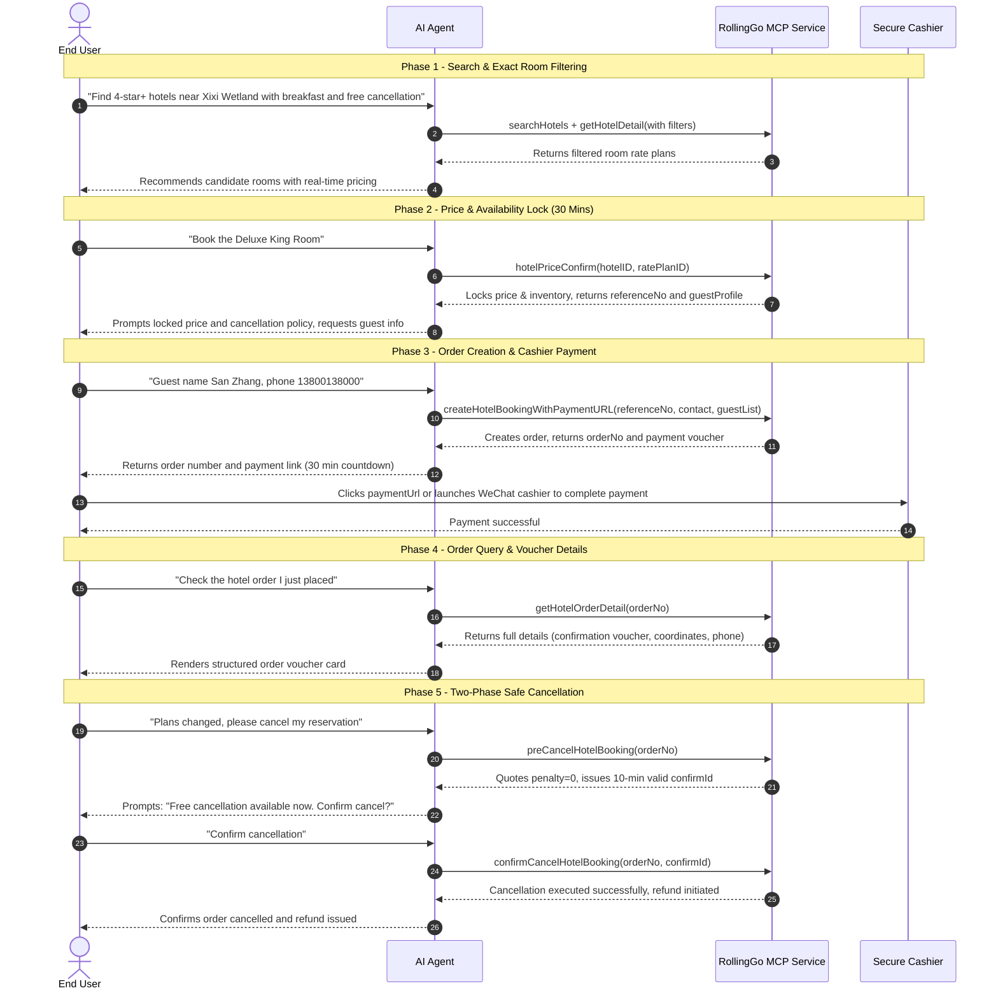

RollingGo Hotel Open Platform offers two core integration modes: **Redirect Mode** and **In-Agent Closed-Loop Mode**. Developers can flexibly select the mode that best fits their product architecture and transaction requirements.

---

## Core Mode Comparison

| Dimension | Redirect Mode (Lightweight Query) | Closed-Loop Mode (In-Agent Transaction) |
| :--- | :--- | :--- |
| **Available Tools** | **3 Tools** (Search, Hotel Details, Search Tags) | **9 Tools** (Full lifecycle from search to checkout and refund) |
| **Agent Core Role** | Search & recommendation, pushing booking link cards | Guiding user through search, price lock, booking, payment, order query, and cancellation |
| **Booking & Payment** | User clicks link to complete booking on **RollingGo Web or Mini Program** | Order created in conversation; user completes payment via **cashier link** |
| **Price Lock Ability** | Not supported | Supports `hotelPriceConfirm` to lock price and room inventory for 30 minutes |
| **Order Management** | User checks orders independently on RollingGo portals | Direct in-conversation queries for order summary list and structured details |
| **Cancellation & Refund** | User navigates to external portal | Two-phase safe cancellation (`preCancelHotelBooking` quote + `confirmCancelHotelBooking` execute) |
| **Authentication** | **API Key Mode** (Header: `Authorization: Bearer <API_KEY>`) | **OAuth 2.0 / 2.1 Mode** (Authorization Code flow with PKCE) |
| **Integration Effort** | Minimal (Setup in 5 minutes) | Standard (Enterprise-grade commercial closed-loop) |
| **Recommended Scenarios** | • Search, comparison, and recommendation agents • Lightweight traffic redirection plugins • Scenarios without direct transaction handling | • Commercial AI travel concierges & assistants • Official brand conversational booking applications • Transaction-oriented agents requiring high conversion |

---

## Mode 1: Redirect Mode Sequence

In Redirect Mode, the Agent only calls query tools. Users complete booking and payment by clicking the `bookingUrl` link card redirected to RollingGo official web or mini program:

---

## Mode 2: Closed-Loop Mode Sequence

In Closed-Loop Mode, the Agent utilizes all 9 tools, orchestrating the complete lifecycle within conversation:

---

## Credentials & Account Provisioning

| Channel | Target Audience | How to Apply | Deliverables |
| :--- | :--- | :--- | :--- |
| **Self-Service Portal** | All developers and creators | Register at [China Portal](https://partner.rollinggo.cn) or [Global Portal](https://partner.rollinggo.ai) | Instant `API Key` generation or OAuth app configuration |
| **Enterprise / Business Provisioning** | Contracted enterprises and partners | Direct provisioning by RollingGo operations team | **API Key Mode**: Dedicated `API Key` & endpoints **OAuth Mode**: `clientId`, `clientSecret` & redirect configs |

> Tip: Partners who received credentials directly from RollingGo operations **do not need to re-register on the open portal**.

---

## Service Endpoints Directory

### Staging Environment

| Service Node | Auth Mode | Endpoint URL | Default Language & Currency |
| :--- | :--- | :--- | :--- |
| **China Staging** | API Key Mode | `https://mcp-test.rollinggo.cn/mcp` | Chinese (`zh-CN`) / CNY (`CNY`) |
| **China Staging** | OAuth 2.0 Mode | `https://travelportal-api-staging.aigohotel.com/api/mcp/hotel` | Chinese (`zh-CN`) / CNY (`CNY`) |
| **Global Staging** | API Key Mode | `https://mcp-test.rollinggo.ai/mcp` | English (`en`) / USD (`USD`) |
| **Global Staging** | OAuth 2.0 Mode | `https://travelportal-api-staging.aigohotel.com/api/mcp/hotel` | English (`en`) / USD (`USD`) |

### Production Environment

| Service Node | Auth Mode | Endpoint URL | Default Language & Currency | Core Highlights |
| :--- | :--- | :--- | :--- | :--- |
| **China Production** | API Key Mode | `https://mcp.rollinggo.cn/mcp` | Chinese (`zh-CN`) / CNY (`CNY`) | Fixed Chinese & CNY, Chinese enum values |
| **China Production** | OAuth 2.0 Mode | `https://mcp.rollinggo.cn/mcp/hotel` | Chinese (`zh-CN`) / CNY (`CNY`) | Strong user-level auth with order isolation |
| **Global Production** | API Key Mode | `https://mcp.rollinggo.ai/mcp` | English (`en`) / USD (`USD`) | Multi-language & 25 currencies real-time exchange |
| **Global Production** | OAuth 2.0 Mode | `https://mcp.rollinggo.ai/mcp/hotel` | English (`en`) / USD (`USD`) | Global end-user authorization system |
