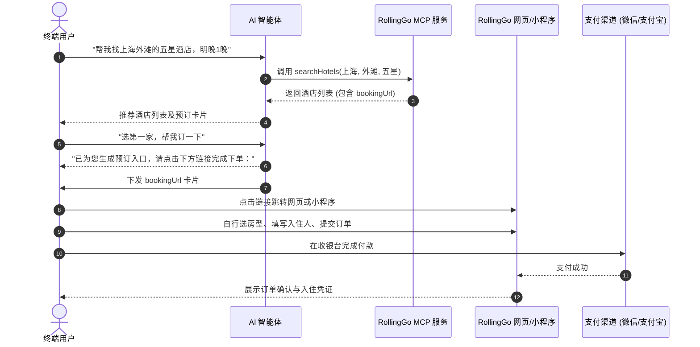
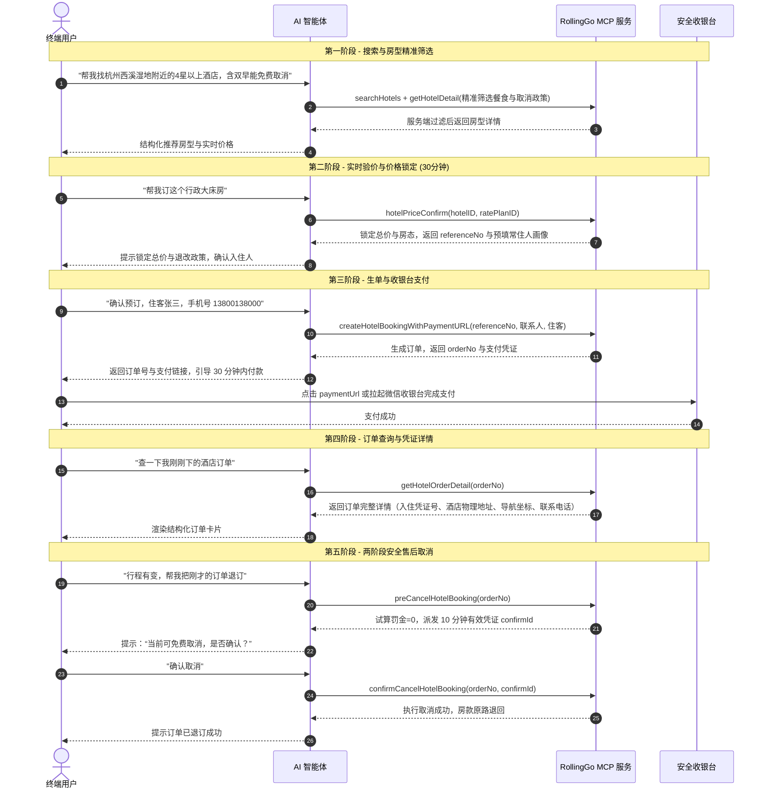

RollingGo 酒店开放平台为合作伙伴提供 **跳转模式** 与 **端内闭环模式** 两种核心接入形态。开发者可根据自身产品定位、交互形态与交易诉求灵活选择。

---

## 两种接入模式核心对比

| 比较维度 | 跳转模式（轻量查询） | 端内闭环模式（交易闭环） |
| :--- | :--- | :--- |
| **可用工具数量** | **3 个工具**（搜索、房型详情、搜索标签） | **9 个工具**（从搜索到下单支付及售后退改） |
| **智能体核心角色** | 负责酒店搜索与推荐，推送预订链接卡片 | 引导用户完成“搜 → 查 → 锁 → 下单 → 支付 → 查单 → 退订”全流程 |
| **下单与支付承载** | 用户点击链接跳转 **RollingGo 网页或微信小程序** 自行下单支付 | 在智能体对话内生单，用户点击**安全收银台链接**完成支付 |
| **价格锁定能力** | 暂不支持锁价 | 支持 `hotelPriceConfirm` 锁定 30 分钟价格与房态，返回常住人画像 |
| **订单管理能力** | 用户在 RollingGo 网页或小程序自行查看 | 支持在对话中直接查询订单列表概要与多维结构化详情 |
| **售后退订能力** | 需用户跳转小程序或网页处理 | 支持两阶段安全取消（`preCancelHotelBooking` 罚金试算 + `confirmCancelHotelBooking` 执行退订） |
| **鉴权认证方式** | **API Key 模式**（Header: `Authorization: Bearer <API_KEY>`） | **OAuth 2.0 / 2.1 模式**（终端用户授权码模式与 PKCE 扩展） |
| **接入成本** | 极简（5 分钟完成配置） | 标准（企业级商业闭环） |
| **推荐适用场景** | • 信息检索与比价聚合类智能体 • 轻量级导航与流量分发插件 • 无需介入交易闭环的场景 | • 商业化深度合作的 AI 旅游助手 • 品牌官方对话式订房应用 • 追求高转化与全流程服务的交易型智能体 |

---

## 模式一：跳转模式时序

在跳转模式下，智能体仅调用查询类工具，用户通过卡片中的 `bookingUrl` 跳转至 RollingGo 官方网页或微信小程序完成预订与支付：

---

## 模式二：端内闭环模式时序

在端内闭环模式下，智能体完整使用全部 9 个工具，实现从信息检索、验价锁价到履约查单、售后退订的全周期闭环：

---

## 账号开通与凭证获取渠道

| 申请途径 | 适用对象 | 开通方式 | 交付凭证 |
| :--- | :--- | :--- | :--- |
| **开放平台自主申请** | 全体开发者、达人与独立团队 | 前往 [国内站](https://partner.rollinggo.cn) 或 [国际站](https://partner.rollinggo.ai) 线上自主注册 | 即时开通 `API Key` 或配置 OAuth 应用 |
| **商务签约直接交付** | 签约企业客户、特约合作方 | 由 RollingGo 运营团队在线下直接建立并交付 | **API Key 模式**：`API Key` 及端点 **OAuth 模式**：`clientId`、`clientSecret` 及回调配置 |

> 提示：已由 RollingGo 运营人员直接交付接入凭证的企业客户，**无需在开放平台重复注册**，直接使用凭证配置客户端即可上线。

---

## 服务节点与接入端点清单

### 测试环境

| 服务节点 | 鉴权模式 | 服务端点 URL | 默认语言与币种 |
| :--- | :--- | :--- | :--- |
| **国内测试节点** | API Key 模式 | `https://mcp-test.rollinggo.cn/mcp` | 中文 (`zh-CN`) / 人民币 (`CNY`) |
| **国内测试节点** | OAuth 2.0 模式 | `https://mcp-test.rollinggo.cn/mcp/hotel` | 中文 (`zh-CN`) / 人民币 (`CNY`) |
| **国际测试节点** | API Key 模式 | `https://mcp-test.rollinggo.ai/mcp` | 英文 (`en`) / 美元 (`USD`) |
| **国际测试节点** | OAuth 2.0 模式 | `https://mcp-test.rollinggo.ai/mcp/hotel` | 英文 (`en`) / 美元 (`USD`) |

### 生产环境

| 服务节点 | 鉴权模式 | 服务端点 URL | 默认语言与币种 | 核心特征说明 |
| :--- | :--- | :--- | :--- | :--- |
| **国内正式节点** | API Key 模式 | `https://mcp.rollinggo.cn/mcp` | 中文 (`zh-CN`) / 人民币 (`CNY`) | 固定中文与人民币，`placeType` 为中文枚举 |
| **国内正式节点** | OAuth 2.0 模式 | `https://mcp.rollinggo.cn/mcp/hotel` | 中文 (`zh-CN`) / 人民币 (`CNY`) | 终端用户强鉴权，订单天然隔离防越权 |
| **国际正式节点** | API Key 模式 | `https://mcp.rollinggo.ai/mcp` | 英文 (`en`) / 美元 (`USD`) | 支持多语言与 25 种外币实时换汇，`placeType` 为英文枚举 |
| **国际正式节点** | OAuth 2.0 模式 | `https://mcp.rollinggo.ai/mcp/hotel` | 英文 (`en`) / 美元 (`USD`) | 国际站终端用户授权登录体系 |
